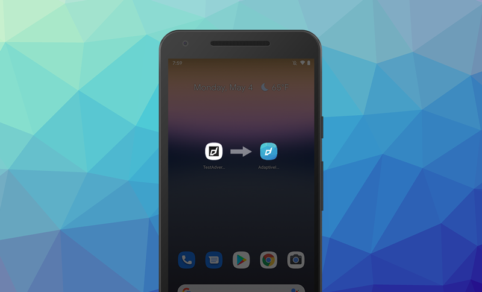
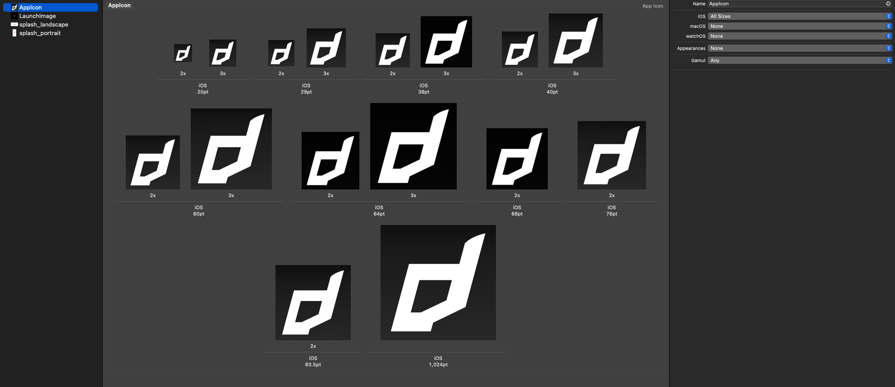

# AIR Image Scripts

These scripts are helpful to generate the required icons assets for an iOS / Android AIR application (including `Assets.car`), the iOS launch storyboard and the Android adaptive icon resources.


|                 |                 | 
| --------------- | --------------- | 
| Adaptive Icons  |   |
  Themed / Tinted Icons |  | 
  Asset Catalogue |  | 

This script requires usage of Xcode tools to be able to generate the iOS resources so you will need to run it on a macOS machine with Xcode installed to be able to generate these icons. 

### More Information

- [Android Adaptive Icons](https://developer.android.com/develop/ui/views/launch/icon_design_adaptive)
- [Apple Icon Guidelines](https://developer.apple.com/design/human-interface-guidelines/app-icons)


## Installation


### Download 

Download the `generateIcons` script from the [releases](https://github.com/distriqt/AIR-ImageScripts/releases) and place it in your path. 


Alternatively you can run the script directly if you require using curl:

```bash
/bin/bash -c "$(curl -fsSL https://github.com/distriqt/AIR-ImageScripts/releases/download/v2.0/generateIcons)"
```


### Dependencies

The script uses imagemagick to resize the images so you need to have this installed.

```
brew install imagemagick
```

> This needs to be at least version 7


It also uses Xcode tools to create the `Assets.car` from your images. You need Xcode and then can install the build tools with:

```
xcode-select --install
```

>
> **Note**
>
> We recommend using Xcode 15 or 16 currently
>
> **Update settings**
>
> Open Xcode and change the following setting:
> 
> `Settings` / `Locations` / `Advanced` : check `Legacy`
>
> This ensures the output of the asset catalogue is in the expected location
>


## Usage

```bash
Usage: generateIcons
Options:
  -s, --source DIR        Source directory (default: current directory)
  -o, --output DIR        Output directory (default: out)
  -f, --foreground FILE   Icon foreground layer image with transparency (default: icon-foreground.png)
  -b, --background FILE   Icon background layer image (default: icon-background.png)
  -m, --monochrome FILE   Icon monochrome image (default: icon-monochrome.png)
  -d, --dark FILE         Dark mode icon image (default: icon-dark.png)
  -i, --icon FILE         Override layered icon image (default: icon.png)
  -a, --alt FILE          Alternate icon image
  -l, --launch FILE       Launch screen image (default: launch.png)
  -c, --color COLOR       Fill background color (default: none)
  -h, --help              Display this help message
```


### Assets

In your source directory you should have your icon images:

```
icon-foreground.png 
icon-background.png 
icon-monochrome.png
icon-dark.png
```

These four base images are used to construct the icons for each of the platforms:

- `icon-foreground.png` should be a transparent icon with no background which will be layered over the background and centered on the launch image
- `icon-background.png` should be a filled image which constitutes the background of adaptive icons and the launch image (generally a solid colour)
- `icon-monochrome.png` similar to the foreground icon except this should be monochrome and will be tinted by the OS to colour match the user's theme
- `icon-dark.png`: a specific dark image to be used as the dark icon on iOS 

### Example Icons

| `icon-foreground.png` | `icon-background.png` | `icon-monochrome.png` | `icon-dark.png` |
| --- | --- | --- | --- |
|  |  |  |  |


Creates an icon like: 

 


### Launch

The script will generate a launch screen for you by centering the foreground icon over the background.

You can alternatively provide a separate 2048x2048 image as the launch image if you require to have more control here.


## Usage Examples


This is likely the most common usage, specifying the source and output directories.  

```bash
generateIcons -s config/icons -o src
```


## Outputs

Currently this script outputs the following icons and default images:

```
|____Assets.car
|____LaunchScreen.storyboardc
|____icons
| |____icon120x120.png
| |____icon48x48.png
| |____icon60x60.png
| |____icon64x64.png
| |____icon58x58.png
| |____icon36x36.png
| |____icon72x72.png
| |____icon20x20.png
| |____icon80x80.png
| |____icon57x57.png
| |____icon180x180.png
| |____icon32x32.png
| |____icon76x76.png
| |____icon1024x1024.png
| |____icon29x29.png
| |____icon152x152.png
| |____icon16x16.png
| |____icon87x87.png
| |____icon512x512.png
| |____icon40x40.png
| |____icon114x114.png
| |____icon144x144.png
| |____icon256x256.png
| |____icon128x128.png
| |____icon167x167.png
|____res
| |____mipmap-anydpi-v26
| | |____icon_round.xml
| | |____icon.xml
| |____mipmap-hdpi
| | |____icon_background.png
| | |____icon_foreground.png
| | |____icon_monochrome.png
| | |____icon_round.png
| | |____icon.png
| |____mipmap-mdpi
| | |____icon_background.png
| | |____icon_foreground.png
| | |____icon_monochrome.png
| | |____icon_round.png
| | |____icon.png
| |____mipmap-xhdpi
| | |____icon_background.png
| | |____icon_foreground.png
| | |____icon_monochrome.png
| | |____icon_round.png
| | |____icon.png
| |____mipmap-xxhdpi
| | |____icon_background.png
| | |____icon_foreground.png
| | |____icon_monochrome.png
| | |____icon_round.png
| | |____icon.png
| |____mipmap-xxxhdpi
| | |____icon_background.png
| | |____icon_foreground.png
| | |____icon_monochrome.png
| | |____icon_round.png
| | |____icon.png
```


Add the following to your application descriptor to pick up these icon image names (edit as required):

```xml
    <icon>
        <image16x16>icons/icon16x16.png</image16x16>
        <image29x29>icons/icon29x29.png</image29x29>
        <image32x32>icons/icon32x32.png</image32x32>
        <image36x36>icons/icon36x36.png</image36x36>
        <image40x40>icons/icon40x40.png</image40x40>
        <image48x48>icons/icon48x48.png</image48x48>
        <image57x57>icons/icon57x57.png</image57x57>
        <image58x58>icons/icon58x58.png</image58x58>
        <image60x60>icons/icon60x60.png</image60x60>
        <image72x72>icons/icon72x72.png</image72x72>
        <image76x76>icons/icon76x76.png</image76x76>
        <image80x80>icons/icon80x80.png</image80x80>
        <image87x87>icons/icon87x87.png</image87x87>
        <image114x114>icons/icon114x114.png</image114x114>
        <image120x120>icons/icon120x120.png</image120x120>
        <image128x128>icons/icon128x128.png</image128x128>
        <image144x144>icons/icon144x144.png</image144x144>
        <image152x152>icons/icon152x152.png</image152x152>
        <image167x167>icons/icon167x167.png</image167x167>
        <image180x180>icons/icon180x180.png</image180x180>
        <image512x512>icons/icon512x512.png</image512x512>
        <image1024x1024>icons/icon1024x1024.png</image1024x1024>
    </icon>
```


Add the following to your iOS info additions for launch storyboard support:

```xml
<key>UILaunchStoryboardName</key>
<string>LaunchScreen</string>
```

Add the following to your app descriptor to specify the android resources:

```xml
<resdir>res</resdir>
```


## Version 1 - `generate.sh`


The script takes several optional parameters:

- [optional] path to the icon image to use as the base, we suggest a 1024x1024 pixel image (defaults to `icon.png`);
- [optional] path to the launch / default image to use as the base, we suggest a large 2732x2732 pixel image (defaults to `launch.png`);
- [optional] colour to use to fill background when required for default images
  - in the format: `"#RRGGBB"`;
- [optional] output path for the files. You can use this to point to the assets output folder of your application (defaults to `out`);
- [optional] path to an alternate icon image which will be added as the `AlternateIcon`, we suggest a 1024x1024 pixel image (defaults to `icon-alt.png`);


`generate.sh` (Version 1) still functions as before but we won't be maintaining it any longer. We wanted to change the input parameters and thought best to create a new script than potentially affect existing build processes. So this script will remain as is. 


### Examples

```
generate.sh icon.png launch.png "#ff0000" 
```

```
generate.sh icon.png launch.png "#ff0000" out icon-alt.png
```


The default:

```
generate.sh
```

uses: 
- icon: `icon.png`
- launch: `launch.png`
- no background colour
- outputs to `out`
- alternate icon: `icon-alt.png`

### Outputs 

This script outputs the same as the v2 except it doesn't handle Android resources and it doesn't handle iOS dark / tinted icons. 
